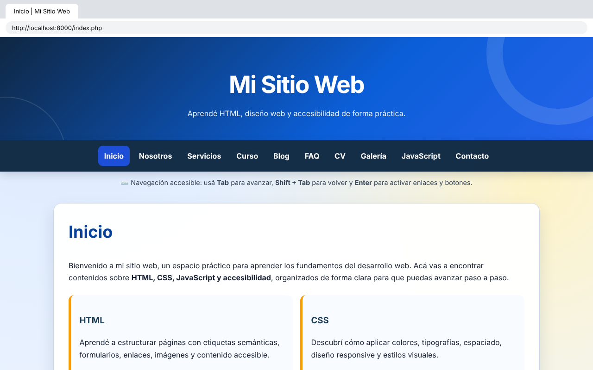
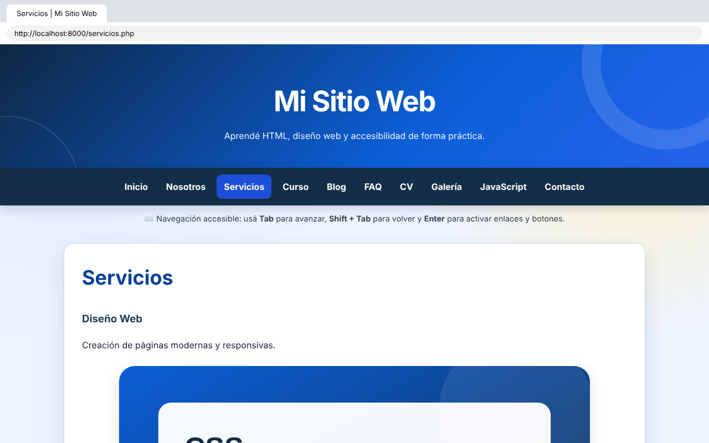

# Mi Sitio Web — Aplicación PHP con SSI y SSR básico

Sitio web accesible sobre HTML, CSS, JavaScript y accesibilidad. En la **Unidad 4** (TP N° 4) la maqueta estática del Hito 1 se refactorizó a una aplicación **PHP**:

- Las 12 pantallas `.html` pasaron a `.php`.
- El código repetido (cabecera, menú y pie de página) se extrajo a plantillas en `includes/` y se incluye con `require_once` (**Server Side Includes**).
- El `<title>`, el ítem activo del menú y el pie de página se generan en el servidor (**SSR básico**).
- Los datos globales (nombre del sitio, email de soporte, entorno) viven en un archivo `.env` que **no** se versiona; se entrega `.env.example` como plantilla.

## Prototipo en Figma

Enlace al prototipo: **no disponible en esta entrega** (la situación se explicó por separado al docente).

## Tecnologías utilizadas

- HTML5 semántico
- CSS3 (diseño responsive, modo oscuro, `prefers-reduced-motion`)
- JavaScript (validaciones, galería, reloj, tema)
- PHP 8.x
- XAMPP / Laragon (servidor local)
- Git y GitHub (ramas, Pull Requests)

## Estructura del proyecto

```
├── .env.example          # Plantilla de variables de entorno (se versiona)
├── .env                  # Variables reales (NO se versiona)
├── .gitignore
├── .htaccess             # Bloquea el acceso web a .env (Apache)
├── config/
│   └── env.php           # Lee .env y define las constantes globales
├── includes/
│   ├── header.php        # <head>, metadatos, CSS, cabecera, <title> dinámico
│   ├── nav.php           # Menú principal con ítem activo
│   └── footer.php        # Pie de página y scripts JS
├── index.php  nosotros.php  servicios.php  curso.php  blog.php  faq.php
├── cv.php  galeria.php  javascript.php  contacto.php
├── politica.php  testimonios.php
├── styles.css  javascript.js
└── assets/
```

## Instalación y ejecución local

1. Instalar [XAMPP](https://www.apachefriends.org/) o [Laragon](https://laragon.org/) con PHP 8.x y iniciar **Apache**.
2. Clonar el repositorio dentro de la carpeta pública del servidor:
   - XAMPP: `C:\xampp\htdocs\`
   - Laragon: `C:\laragon\www\`

   ```bash
   git clone <URL_DEL_REPOSITORIO> sitio_web
   ```
3. Crear el archivo de configuración a partir de la plantilla:

   ```bash
   cd sitio_web
   cp .env.example .env      # en Windows (cmd): copy .env.example .env
   ```
4. Editar `.env` si hace falta (nombre del sitio, email de soporte).
5. Abrir en el navegador: `http://localhost/sitio_web/` (en Laragon también `http://sitio_web.test`).

### Variables de entorno

| Variable        | Descripción                                          | Ejemplo               |
|-----------------|------------------------------------------------------|-----------------------|
| `APP_NAME`      | Nombre de la aplicación (cabecera y `<title>`)       | `Mi Sitio Web`        |
| `APP_OWNER`     | Titular que aparece en el pie de página              | `WayerFC`             |
| `SUPPORT_EMAIL` | Email de soporte / contacto                          | `soporte@example.com` |
| `APP_ENV`       | Entorno de ejecución (`local` muestra errores de PHP)| `local`               |

## Cómo funcionan las plantillas

Cada vista define sus variables y luego incluye las plantillas:

```php
<?php
$titulo_pagina = 'Servicios';
require_once __DIR__ . '/includes/header.php';
require_once __DIR__ . '/includes/nav.php';
?>
<main id="contenido-principal">
  <!-- contenido propio de la página -->
</main>
<?php require_once __DIR__ . '/includes/footer.php'; ?>
```

Variables opcionales: `$encabezado_titulo`, `$encabezado_subtitulo`, `$hint_teclado` y `$scripts_extra` (ver comentarios en cada plantilla).

## Evidencia de funcionamiento

> Guardar las capturas en `docs/capturas/` y verificar que los nombres coincidan.

### Servidor local ejecutándose


### Estructura modular (SSI)


### Navegación dinámica (título de pestaña y clase `active`)


### Configuración de variables de entorno


## Accesibilidad

Se mantienen las mejoras del Hito 1: enlace "Saltar al contenido principal", foco visible, `lang="es"`, textos alternativos, formularios con `label` y contraste verificado. Detalles en [`README_ACCESIBILIDAD.md`](README_ACCESIBILIDAD.md) y [`PRUEBA_TECLADO.md`](PRUEBA_TECLADO.md).
