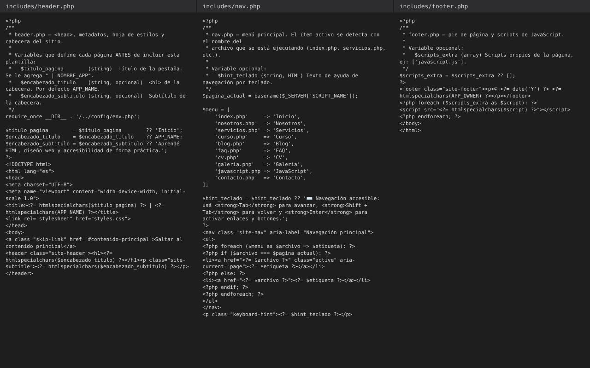
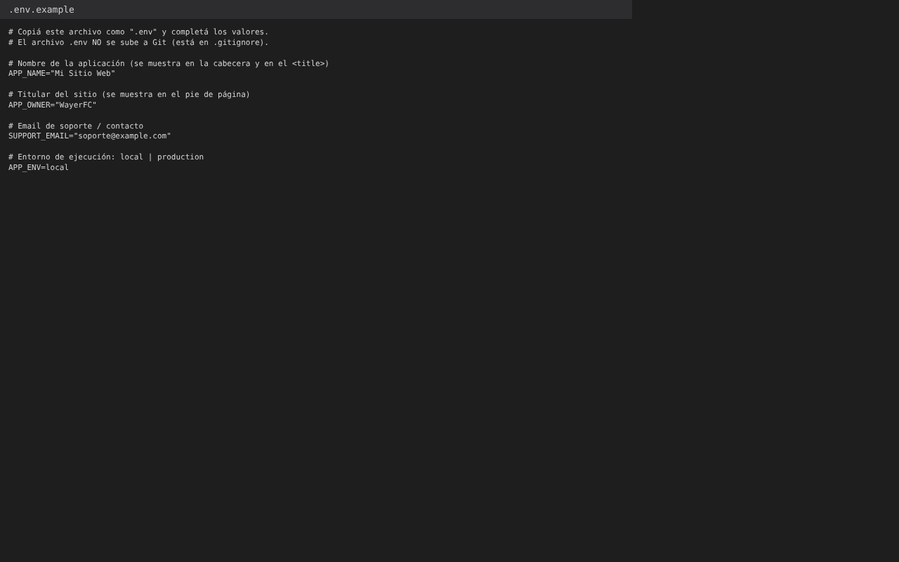
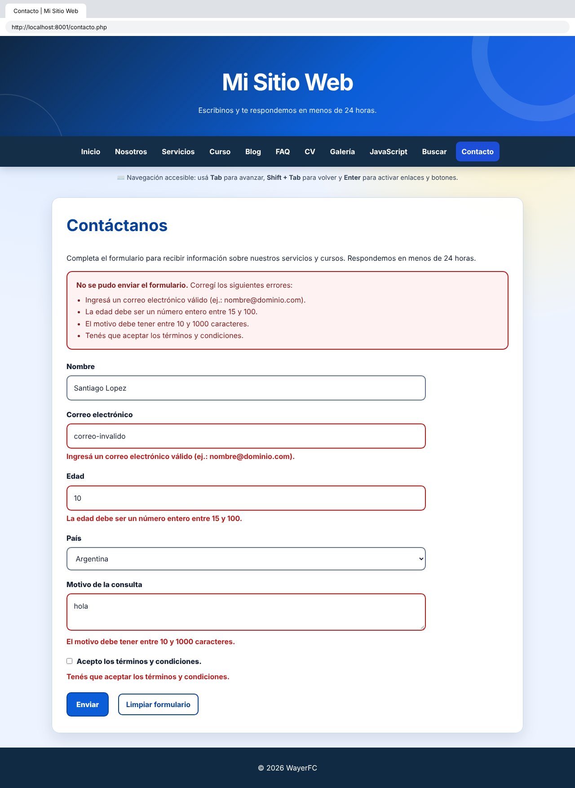
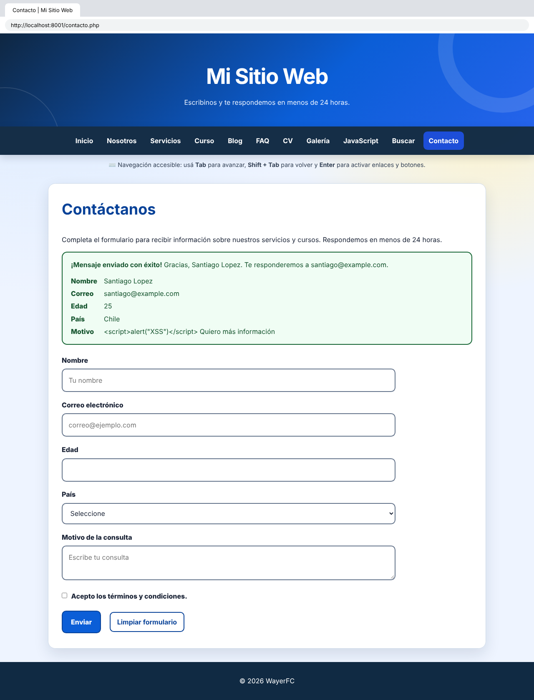
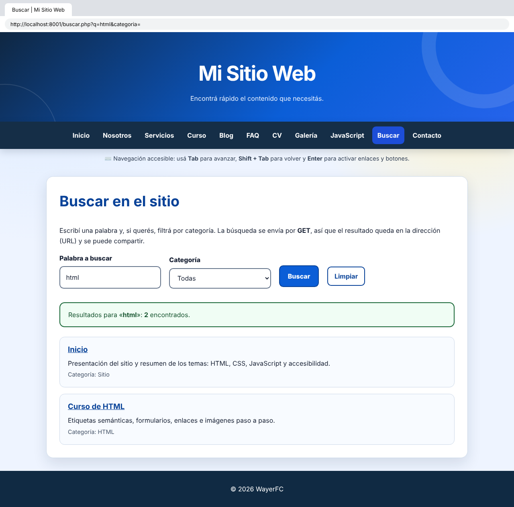
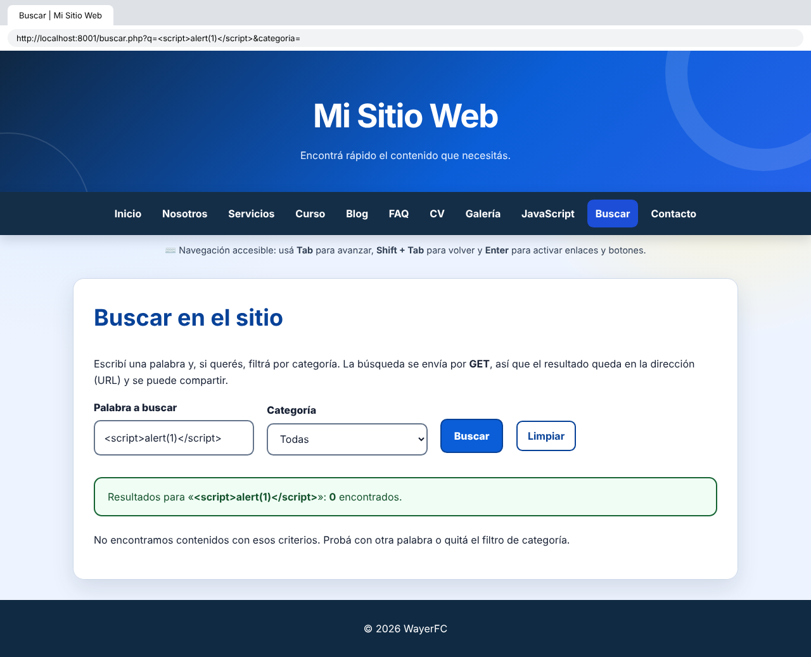
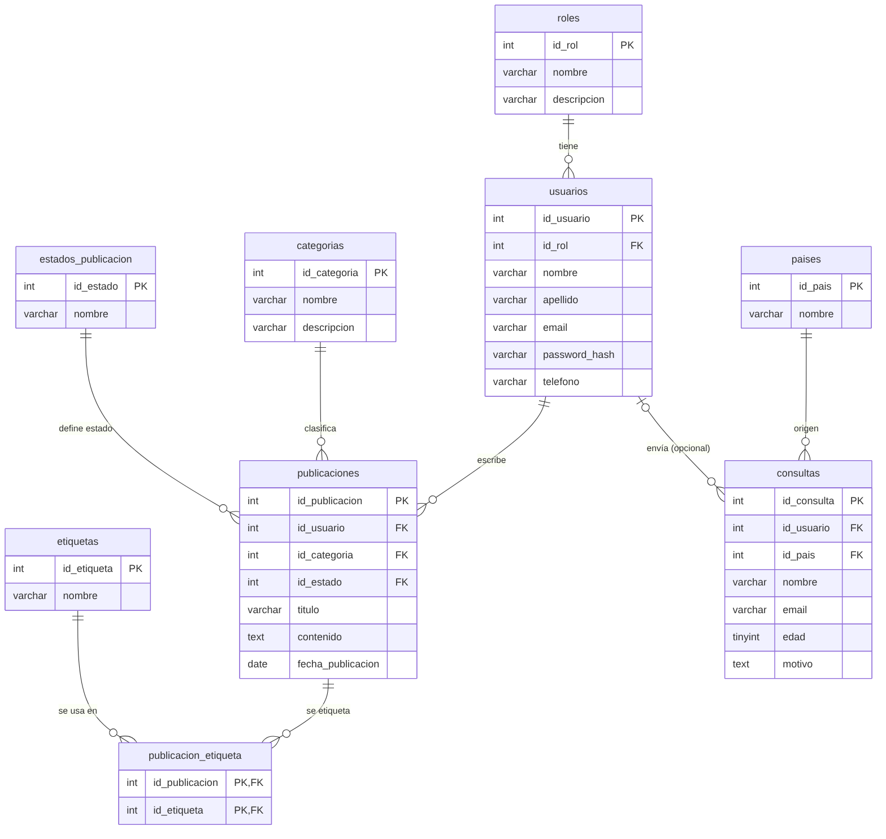

# Mi Sitio Web — Aplicación PHP con SSI y SSR básico

Sitio web accesible sobre HTML, CSS, JavaScript y accesibilidad. En la **Unidad 4** (TP N° 4) la maqueta estática del Hito 1 se refactorizó a una aplicación **PHP**:

- Las 12 pantallas `.html` pasaron a `.php`.
- El código repetido (cabecera, menú y pie de página) se extrajo a plantillas en `includes/` y se incluye con `require_once` (**Server Side Includes**).
- El `<title>`, el ítem activo del menú y el pie de página se generan en el servidor (**SSR básico**).
- Los datos globales (nombre del sitio, email de soporte, entorno) viven en un archivo `.env` que **no** se versiona; se entrega `.env.example` como plantilla.

## Prototipo en Figma

Enlace al prototipo: **no disponible en esta entrega** (la situación se explicó por separado al docente).

## Tecnologías utilizadas

- HTML5 semántico
- CSS3 (diseño responsive, modo oscuro, `prefers-reduced-motion`)
- JavaScript (validaciones, galería, reloj, tema)
- PHP 8.x
- XAMPP / Laragon (servidor local)
- Git y GitHub (ramas, Pull Requests)

## Estructura del proyecto

```
├── .env.example          # Plantilla de variables de entorno (se versiona)
├── .env                  # Variables reales (NO se versiona)
├── .gitignore
├── .htaccess             # Bloquea el acceso web a .env (Apache)
├── config/
│   └── env.php           # Lee .env y define las constantes globales
├── includes/
│   ├── header.php        # <head>, metadatos, CSS, cabecera, <title> dinámico
│   ├── nav.php           # Menú principal con ítem activo
│   └── footer.php        # Pie de página y scripts JS
├── index.php  nosotros.php  servicios.php  curso.php  blog.php  faq.php
├── cv.php  galeria.php  javascript.php  contacto.php
├── politica.php  testimonios.php
├── styles.css  javascript.js
└── assets/
```

## Instalación y ejecución local

1. Instalar [XAMPP](https://www.apachefriends.org/) o [Laragon](https://laragon.org/) con PHP 8.x y iniciar **Apache**.
2. Clonar el repositorio dentro de la carpeta pública del servidor:
   - XAMPP: `C:\xampp\htdocs\`
   - Laragon: `C:\laragon\www\`

   ```bash
   git clone <URL_DEL_REPOSITORIO> sitio_web
   ```
3. Crear el archivo de configuración a partir de la plantilla:

   ```bash
   cd sitio_web
   cp .env.example .env      # en Windows (cmd): copy .env.example .env
   ```
4. Editar `.env` si hace falta (nombre del sitio, email de soporte).
5. Abrir en el navegador: `http://localhost/sitio_web/` (en Laragon también `http://sitio_web.test`).

### Variables de entorno

| Variable        | Descripción                                          | Ejemplo               |
|-----------------|------------------------------------------------------|-----------------------|
| `APP_NAME`      | Nombre de la aplicación (cabecera y `<title>`)       | `Mi Sitio Web`        |
| `APP_OWNER`     | Titular que aparece en el pie de página              | `WayerFC`             |
| `SUPPORT_EMAIL` | Email de soporte / contacto                          | `soporte@example.com` |
| `APP_ENV`       | Entorno de ejecución (`local` muestra errores de PHP)| `local`               |

## Cómo funcionan las plantillas

Cada vista define sus variables y luego incluye las plantillas:

```php
<?php
$titulo_pagina = 'Servicios';
require_once __DIR__ . '/includes/header.php';
require_once __DIR__ . '/includes/nav.php';
?>
<main id="contenido-principal">
  <!-- contenido propio de la página -->
</main>
<?php require_once __DIR__ . '/includes/footer.php'; ?>
```

Variables opcionales: `$encabezado_titulo`, `$encabezado_subtitulo`, `$hint_teclado` y `$scripts_extra` (ver comentarios en cada plantilla).

## Evidencia de funcionamiento

> Guardar las capturas en `docs/capturas/` y verificar que los nombres coincidan.

### Servidor local ejecutándose


### Estructura modular (SSI)


### Navegación dinámica (título de pestaña y clase `active`)


### Configuración de variables de entorno


## Accesibilidad

Se mantienen las mejoras del Hito 1: enlace "Saltar al contenido principal", foco visible, `lang="es"`, textos alternativos, formularios con `label` y contraste verificado. Detalles en [`README_ACCESIBILIDAD.md`](README_ACCESIBILIDAD.md) y [`PRUEBA_TECLADO.md`](PRUEBA_TECLADO.md).

---

# Clase 5 — Procesamiento de formularios (POST y GET) y prevención de XSS

Todo el desarrollo de esta entrega está en la carpeta [`clase5/`](clase5/). Es una copia del proyecto PHP (con las plantillas `includes/`) a la que se le agregó lógica del lado del servidor para capturar y procesar datos enviados desde el navegador.

**Cómo ejecutarlo:** copiar el repositorio en `htdocs` (XAMPP) o `www` (Laragon), copiar `clase5/.env.example` como `clase5/.env` y abrir `http://localhost/sitio_web/clase5/`.

## Formularios creados

### 1. Formulario de contacto — método **POST** (`clase5/contacto.php`)
Envía nombre, correo, edad, país, motivo y aceptación de términos. Los datos viajan en el cuerpo de la petición.

| Campo | Validación en servidor |
|---|---|
| Nombre | Obligatorio, 3–40 caracteres, solo letras/espacios/`.`/`'`/`-` |
| Correo | Obligatorio, formato válido con `filter_var(..., FILTER_VALIDATE_EMAIL)` |
| Edad | Obligatoria, entero entre 15 y 100 (`FILTER_VALIDATE_INT`) |
| País | Obligatorio, debe existir en la lista permitida |
| Motivo | Obligatorio, 10–1000 caracteres |
| Términos | Obligatorio (checkbox marcado) |

- **Mensajes:** si hay errores se muestra un recuadro rojo con la lista y un mensaje junto a cada campo; si todo está bien, un recuadro verde de éxito con el resumen de lo enviado.
- **Persistencia:** ante un error, los campos completados se conservan (inputs, `select`, `textarea` y checkbox).
- **Extra:** token CSRF de un solo uso en el formulario.

### 2. Buscador — método **GET** (`clase5/buscar.php`)
Busca una palabra y/o filtra por categoría sobre los contenidos del sitio. Los parámetros viajan en la URL (`buscar.php?q=html&categoria=`), por lo que la búsqueda se puede compartir.

- Validación: se requiere un término o una categoría, el término debe tener entre 2 y 50 caracteres y la categoría debe ser una de las permitidas.
- Mensajes: cantidad de resultados, "sin resultados" y errores de validación. Los valores buscados se conservan en el formulario.

## Sanitización y seguridad (OWASP Top 10 — XSS)

Las funciones están centralizadas en [`clase5/includes/funciones.php`](clase5/includes/funciones.php):

1. **Entrada:** nunca se usa `$_POST` / `$_GET` directo. Se lee con `filter_input()`, se aplica `trim()` y se eliminan caracteres de control (`entrada_post()` / `entrada_get()`).
2. **Validación:** `isset()`/vacío, longitudes, `filter_var()` para correo y enteros, listas blancas para país y categoría.
3. **Salida:** todo dato que se imprime pasa por `e()` (`htmlspecialchars` con `ENT_QUOTES` y UTF-8), así `<script>` se muestra como texto y no se ejecuta.

## Evidencia de funcionamiento

**POST — errores de validación con los campos conservados**


**POST — envío exitoso**


**POST — intento de XSS en el motivo (se muestra escapado, no se ejecuta)**


**GET — resultados de búsqueda (parámetros en la URL)**


**GET — validación (término demasiado corto)**


**GET — intento de XSS en la búsqueda (escapado)**


---

# TP 6 — Normalización y base de datos MySQL

Todo el desarrollo está en la carpeta [`tp6/`](tp6/):

| Archivo | Contenido |
|---|---|
| [`NORMALIZACION.md`](tp6/NORMALIZACION.md) | Parte 1: tabla sin normalizar, 1FN, 2FN, 3FN, listado de tablas con PK/FK y diagrama entidad-relación |
| [`schema.sql`](tp6/schema.sql) | Parte 2: creación de la base `mi_sitio_web` (9 tablas, claves primarias autoincrementales, claves foráneas, campos de auditoría `created_at`/`updated_at` e índices) |
| [`consultas.sql`](tp6/consultas.sql) | Parte 3: pruebas CRUD (INSERT, SELECT con WHERE/ORDER BY e INNER JOIN, UPDATE y DELETE con WHERE) |

**Cómo ejecutarlo (XAMPP / Laragon):**
1. Iniciar Apache y MySQL.
2. Abrir phpMyAdmin → pestaña **Importar** → elegir `tp6/schema.sql` → **Continuar**.
3. Importar `tp6/consultas.sql` de la misma forma (se puede ejecutar varias veces).

> `schema.sql` borra y vuelve a crear las tablas del proyecto, por lo que reinicia los datos de la base `mi_sitio_web`.


