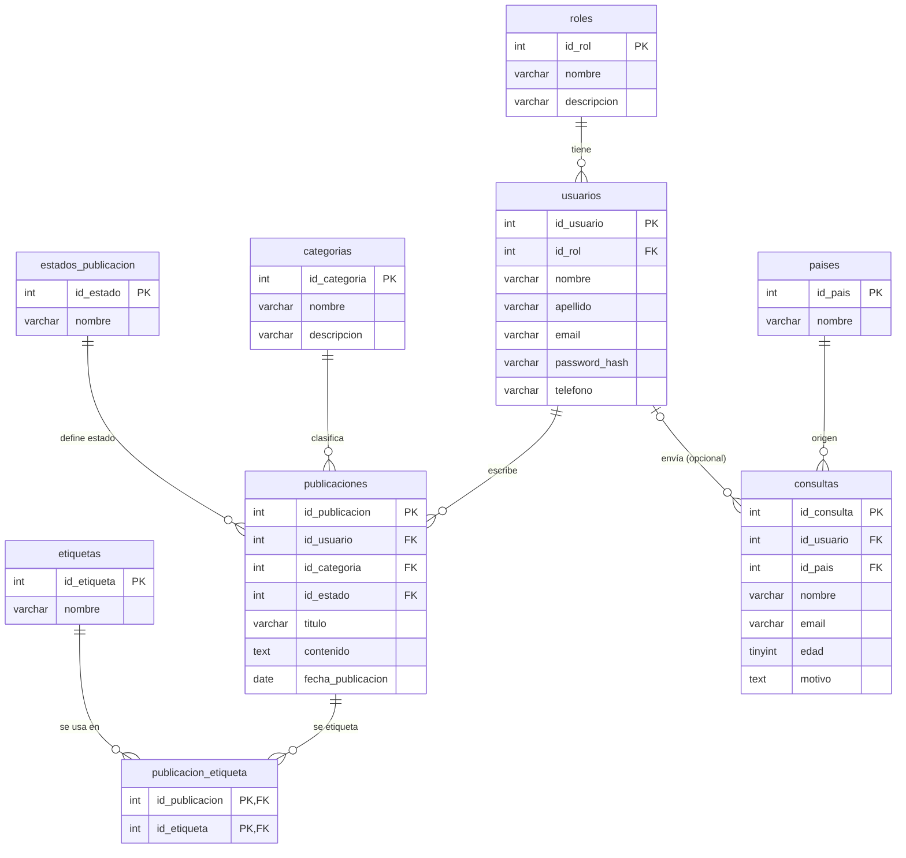

# TP 6 — Normalización del proyecto integrador

**Proyecto:** Mi Sitio Web — sitio de aprendizaje de HTML, CSS, JavaScript y accesibilidad, con blog de contenidos y formulario de contacto (desarrollado en PHP en los TP anteriores).

**Sistema elegido para normalizar:** el **blog de contenidos** (publicaciones con autor, categoría, estado y etiquetas) y las **consultas** recibidas por el formulario de contacto de la Clase 5.

---

## Parte 1 — Entidad principal SIN normalizar

Registro hipotético de una única tabla `blog_sin_normalizar`, tal como se podría armar en una planilla al comenzar el proyecto:

| id_publicacion | titulo | autor_nombre | autor_email | autor_telefono | autor_rol | rol_descripcion | categoria | categoria_descripcion | estado | etiquetas | fecha_publicacion |
|---|---|---|---|---|---|---|---|---|---|---|---|
| 1 | Guía de HTML semántico | Santiago Lopez | santiago@example.com | 387-5111111 | Administrador | Gestiona todo el sitio | HTML | Contenidos sobre estructura web | Publicado | html, accesibilidad, semántica | 2026-11-01 |
| 2 | Flexbox en 10 minutos | Santiago Lopez | santiago@example.com | 387-5111111 | Administrador | Gestiona todo el sitio | CSS | Contenidos sobre estilos y diseño | Publicado | css, layout | 2026-11-05 |
| 3 | Validar formularios con JS | Ana Perez | ana@example.com | 387-5222222 | Editor | Redacta y edita publicaciones | JavaScript | Contenidos sobre interactividad | Borrador | javascript, formularios, validación | NULL |

### Problemas que se observan

- **Campo multivalorado:** `etiquetas` guarda varios valores en una sola celda (`html, accesibilidad, semántica`). No se puede filtrar bien por etiqueta ni contarlas.
- **Redundancia:** los datos de *Santiago Lopez* (nombre, email, teléfono, rol) y la descripción de las categorías se repiten en cada publicación.
- **Anomalía de actualización:** si Santiago cambia su teléfono, hay que modificarlo en todas sus filas; si se olvida una, los datos quedan inconsistentes.
- **Anomalía de inserción:** no se puede registrar una categoría nueva sin crear una publicación.
- **Anomalía de borrado:** al borrar la única publicación de una categoría se pierde también la descripción de esa categoría.

---

## Parte 2 — Proceso de normalización

### Primera Forma Normal (1FN)

**Regla:** todos los campos deben ser atómicos (un solo valor) y no debe haber grupos repetitivos.

**Acción:** el campo `etiquetas` se separa en un valor por fila. Aparece una clave primaria compuesta **(id_publicacion, etiqueta)**.

`blog_1fn` — PK: (`id_publicacion`, `etiqueta`)

| id_publicacion | etiqueta | titulo | autor_nombre | autor_email | autor_telefono | autor_rol | rol_descripcion | categoria | categoria_descripcion | estado | fecha_publicacion |
|---|---|---|---|---|---|---|---|---|---|---|---|
| 1 | html | Guía de HTML semántico | Santiago Lopez | santiago@example.com | 387-5111111 | Administrador | Gestiona todo el sitio | HTML | Contenidos sobre estructura web | Publicado | 2026-11-01 |
| 1 | accesibilidad | Guía de HTML semántico | Santiago Lopez | santiago@example.com | 387-5111111 | Administrador | Gestiona todo el sitio | HTML | Contenidos sobre estructura web | Publicado | 2026-11-01 |
| 1 | semántica | Guía de HTML semántico | Santiago Lopez | santiago@example.com | 387-5111111 | Administrador | Gestiona todo el sitio | HTML | Contenidos sobre estructura web | Publicado | 2026-11-01 |
| 2 | css | Flexbox en 10 minutos | Santiago Lopez | santiago@example.com | 387-5111111 | Administrador | Gestiona todo el sitio | CSS | Contenidos sobre estilos y diseño | Publicado | 2026-11-05 |
| 2 | layout | Flexbox en 10 minutos | Santiago Lopez | santiago@example.com | 387-5111111 | Administrador | Gestiona todo el sitio | CSS | Contenidos sobre estilos y diseño | Publicado | 2026-11-05 |
| 3 | javascript | Validar formularios con JS | Ana Perez | ana@example.com | 387-5222222 | Editor | Redacta y edita publicaciones | JavaScript | Contenidos sobre interactividad | Borrador | NULL |
| … | … | … | … | … | … | … | … | … | … | … | … |

Ahora cada celda tiene un único valor (1FN cumplida), pero la redundancia empeoró: todo se repite una vez por etiqueta.

### Segunda Forma Normal (2FN)

**Regla:** estar en 1FN y que **todo atributo no clave dependa de la clave primaria completa**, no de una parte de ella.

**Análisis de dependencias funcionales** con la PK compuesta (`id_publicacion`, `etiqueta`):

- `id_publicacion → titulo, autor_nombre, autor_email, autor_telefono, autor_rol, rol_descripcion, categoria, categoria_descripcion, estado, fecha_publicacion`
  Dependen **solo de una parte** de la clave (`id_publicacion`) → **dependencia parcial**.
- `etiqueta` no determina ningún otro atributo de esta tabla.

**Acción:** se descompone en dos tablas.

`publicaciones_2fn` — PK: `id_publicacion`

| id_publicacion | titulo | autor_nombre | autor_email | autor_telefono | autor_rol | rol_descripcion | categoria | categoria_descripcion | estado | fecha_publicacion |
|---|---|---|---|---|---|---|---|---|---|---|
| 1 | Guía de HTML semántico | Santiago Lopez | santiago@example.com | 387-5111111 | Administrador | Gestiona todo el sitio | HTML | Contenidos sobre estructura web | Publicado | 2026-11-01 |
| 2 | Flexbox en 10 minutos | Santiago Lopez | santiago@example.com | 387-5111111 | Administrador | Gestiona todo el sitio | CSS | Contenidos sobre estilos y diseño | Publicado | 2026-11-05 |
| 3 | Validar formularios con JS | Ana Perez | ana@example.com | 387-5222222 | Editor | Redacta y edita publicaciones | JavaScript | Contenidos sobre interactividad | Borrador | NULL |

`publicacion_etiqueta_2fn` — PK: (`id_publicacion`, `etiqueta`); FK: `id_publicacion`

| id_publicacion | etiqueta |
|---|---|
| 1 | html |
| 1 | accesibilidad |
| 1 | semántica |
| 2 | css |
| 2 | layout |
| 3 | javascript |
| 3 | formularios |
| 3 | validación |

Se eliminó la repetición provocada por las etiquetas.

### Tercera Forma Normal (3FN)

**Regla:** estar en 2FN y **no tener dependencias transitivas** (un atributo no clave que depende de otro atributo no clave).

**Dependencias transitivas detectadas en `publicaciones_2fn`:**

| Dependencia | Qué atributos se separan | Nueva tabla |
|---|---|---|
| `id_publicacion → autor_email → autor_nombre, autor_telefono, autor_rol` | Datos personales del autor | `usuarios` |
| `autor_rol → rol_descripcion` | Descripción del rol | `roles` |
| `id_publicacion → categoria → categoria_descripcion` | Descripción de la categoría | `categorias` |
| `id_publicacion → estado` (catálogo de estados) | Nombre del estado | `estados_publicacion` |
| `etiqueta` (texto repetido en la tabla puente) | Nombre de la etiqueta | `etiquetas` |

En cada caso, el atributo original se reemplaza por una **clave foránea** (`id_usuario`, `id_rol`, `id_categoria`, `id_estado`, `id_etiqueta`). La tabla puente pasa a relacionar identificadores.

### Normalización del formulario de contacto (Clase 5)

Las consultas recibidas por el formulario de contacto tienen los campos `nombre`, `email`, `edad`, `pais`, `motivo` y `acepto_terminos`.

- **1FN:** todos los campos son atómicos.
- **2FN:** la PK es simple (`id_consulta`), por lo que no hay dependencias parciales.
- **3FN:** `pais` guardado como texto repite nombres (`Argentina`, `argentina`, `ARGENTINA`). Se extrae a la tabla `paises` y `consultas` guarda `id_pais`. Además se permite vincular la consulta con un usuario registrado (`id_usuario`, opcional).

---

## Parte 3 — Listado de tablas resultante (3FN)

| Tabla | Clave primaria (PK) | Claves foráneas (FK) | Descripción |
|---|---|---|---|
| `roles` | `id_rol` | — | Maestra de roles de usuario |
| `usuarios` | `id_usuario` | `id_rol` → `roles.id_rol` | Usuarios: autenticación (email, password), rol y datos personales |
| `categorias` | `id_categoria` | — | Maestra de categorías de publicaciones |
| `estados_publicacion` | `id_estado` | — | Maestra de estados (Borrador, Publicado, Archivado) |
| `etiquetas` | `id_etiqueta` | — | Maestra de etiquetas |
| `publicaciones` | `id_publicacion` | `id_usuario` → `usuarios.id_usuario` `id_categoria` → `categorias.id_categoria` `id_estado` → `estados_publicacion.id_estado` | Tabla principal de negocio (blog) |
| `publicacion_etiqueta` | (`id_publicacion`, `id_etiqueta`) | `id_publicacion` → `publicaciones.id_publicacion` `id_etiqueta` → `etiquetas.id_etiqueta` | Tabla de relación N:M entre publicaciones y etiquetas |
| `paises` | `id_pais` | — | Maestra de países para el formulario de contacto |
| `consultas` | `id_consulta` | `id_pais` → `paises.id_pais` `id_usuario` → `usuarios.id_usuario` (opcional) | Consultas recibidas por el formulario de contacto |

### Diagrama entidad-relación

Versión en imagen del diagrama: [`diagrama-er.png`](diagrama-er.png).

### Resultado

Con la 3FN se eliminan los datos repetidos y las anomalías:

- cambiar el teléfono de un autor se hace en **una sola fila** de `usuarios`;
- una categoría o etiqueta nueva se puede crear **sin** tener publicaciones;
- borrar una publicación **no** borra la categoría, el autor ni la etiqueta;
- las etiquetas se pueden contar y filtrar porque cada una es una fila.

Los scripts que implementan este modelo son [`schema.sql`](schema.sql) (estructura) y [`consultas.sql`](consultas.sql) (pruebas CRUD).
